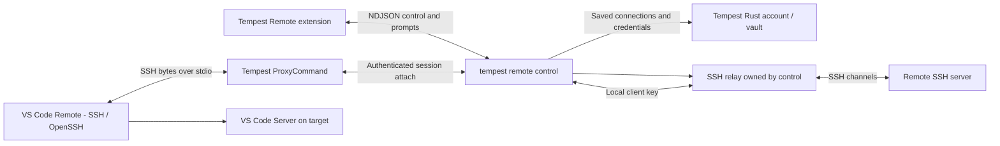

# Tempest Remote — Architecture & Control Protocol

Tempest Remote provides the saved-server selection and authentication UI for **Microsoft Remote - SSH**. It does not implement a separate VS Code remote-authority provider. Remote - SSH owns VS Code Server bootstrap, remote file access and the remote extension host.

## Components



The extension runs **locally** (`extensionKind: ui`). It launches the CLI with an executable path and an argument array, without shell interpolation.

Rust resolves the saved server, keys, proxies and jump hosts and authenticates the upstream SSH connection. A local SSH service listens on `127.0.0.1` at an available port and forwards supported channels to that authenticated connection. OpenSSH authenticates to the local service with a generated client key.

This service is more than a terminal stream: Remote - SSH needs exec requests, stdin EOF, separate stdout/stderr, exit status and `direct-tcpip` channels for TCP forwarding.

The Tempest desktop backend remains account agnostic. Account access and remote credentials belong to Rust/CLI; the desktop renderer does not need to stay online.

## Project boundaries and naming

- **VS Code extension project:** `tempest-vscode`.
- **Product / display name:** Tempest Remote.
- **Marketplace identity:** `AltasExpressLLC.tempest-remote`.
- **Control entry point:** `tempest remote control --protocol 1`.
- **SSH ProxyCommand:** `tempest remote pipe --host <alias> --session <session-id>`.
- **CLI implementation:** `tempest-cli/src/cli/remote.rs`.
- **SSH relay implementation:** `tempest-core/src/ssh/remote.rs`.
- **Extension license:** MIT, copyright Altas Express LLC. This does not relicense Rust/CLI or other Tempest products.

## Control transport

The CLI's stdin/stdout carry **UTF-8 newline-delimited JSON**, exclusively for control messages. SSH protocol bytes use the ProxyCommand's stdin/stdout and an authenticated loopback attach endpoint instead. The control process bridges that endpoint to its local SSH relay. The two channels must not be mixed.

Request frames and authentication responses have a 64 KiB framing limit. Request and prompt IDs correlate responses. The CLI serializes setup operations with file locks, bounds local connections/channels, and atomically replaces private configuration files.

### Requests

```json
{"type":"request","id":"1","method":"capabilities","params":{}}
{"type":"response","id":"1","result":{"protocol":1}}
```

| Method | Parameters | Result |
| --- | --- | --- |
| `capabilities` | `{}` | `{ "protocol": 1 }` |
| `servers.list` | `{}` | Array of `{ "id": "opaque-source", "label": "Server", "description": "host:port" }`. |
| `remote.ensure` | `{ "serverId": "opaque-source", "configFile": "/absolute/ssh/config" }`; configFile is optional. | `{ "sshHost": "tempest-<stable-hash>", "sessionId": "<connection-id>" }` after authentication, local service startup and SSH config preparation. |

Server IDs are opaque to the extension. They retain account, vault and saved-server scope. New SSH aliases combine a sanitized saved name with a short hash of that identity. Existing configurations keep their assigned alias; reconnecting or renaming a saved server does not rename an existing connection. The private attach/storage identity remains independent of the displayed alias.

A response can instead contain `error: { "code": "..." }`. The extension maps known codes to local messages rather than displaying arbitrary transport diagnostics that could contain credentials.

Examples include `account_unavailable`, `vault_unavailable`, `forwarding_not_in_plan`, `forwarding_forbidden`, `upstream_connection_failed`, `remote_key_unavailable`, `ssh_config_unavailable`, `remote_failed` and `cancelled`.

### Interactive prompts

```json
{"type":"prompt","id":"p1","kind":"password","message":"Private key passphrase"}
{"type":"prompt_response","id":"p1","value":"<user-input>"}
```

| Kind | Response value | UI |
| --- | --- | --- |
| `password` | String. | Hidden InputBox. |
| `text` | String. | Visible InputBox. |
| `confirm` | `true` for explicit approval. | Confirmation dialog. |
| `select` | Selected choice ID. | QuickPick; prompt carries `choices: [{ "id": "a", "label": "Account A" }]`. |

`select` is supported by the extension transport; the current connection flow selects servers separately and uses the CLI's default account.

Cancellation is explicit:

```json
{"type":"prompt_response","id":"p1","cancelled":true}
```

It cancels the affected authentication/request. Keyboard-interactive authentication can produce several prompt rounds. Rust's connect callbacks bridge each question to the UI. Passwords and passphrases travel through the control pipe, not argv or logs.

## Keys and SSH configuration

The CLI creates a local host key and a local client key for each stable alias. The local service only accepts the matching client's valid public-key authentication. Loopback access alone is not sufficient.

OpenSSH pins the local service's host key. Rust separately verifies the upstream target and each jump host. Newly trusted fingerprints are written through the shared saved-document path.

Managed files live under `~/.tempest/remotes/`. The CLI inserts an idempotent managed Include at the top of the effective SSH config, using `remote.SSH.configFile` when supplied. Keys remain private files with restricted permissions. Remote passwords and remote private keys are not exported into these generated SSH entries.

## Connection ownership

1. The extension launches control, requests setup and handles all authentication prompts.
2. Control authenticates upstream, creates the SSH relay and an attach endpoint, and returns a session ID and stable SSH alias. Each session descriptor has an unguessable attach capability and owner-only permissions; upstream credentials never enter it.
3. The CLI writes a ProxyCommand containing the executable, alias and session ID. OpenSSH launches the pipe process, which reads its private session descriptor and authenticates its attach to that control.
4. After the attach acknowledgement, the pipe carries raw SSH bytes only. Control bridges those bytes to its SSH relay and continues owning the upstream tunnel. Closing the original editor's JSON control pipe does not interrupt window handoff.
5. The last data pipe's disconnection starts a **three-second reconnect grace**. With no replacement pipe, control closes its relay/tunnel and exits. Before the first attach, setup has a **120-second handoff timeout**. An explicit ensure of an idle live session renews that startup allowance; ordinary probes do not.
6. Control shutdown closes every attached socket, so pipes exit even if their stdin is still open. Pipe stdin EOF half-closes the connection to allow trailing output; it has a five-second drain bound.

On Unix, ProxyCommand forwards **SIGHUP, SIGINT and SIGTERM** through a separate authenticated side connection, addressing its control session and individual pipe ID. Control closes that attach; other SSH pipes remain usable. If it was the last attach, control releases the tunnel immediately and exits with `128 + signal`; the proxy uses the same signal exit status. OpenSSH also sends SIGHUP during normal ProxyCommand cleanup, so forwarding must not terminate unrelated attaches. Normal EOF releases that pipe and follows reconnect grace. Signalling the control process itself shuts down every attach it owns. Terminal Ctrl+C remains SSH data. Signal forwarding is not inserted into the SSH byte stream and does not send POSIX process signals to remote commands. Windows retains pipe/EOF cleanup; Unix signal forwarding is platform-specific.

Multiple SSH pipes can attach to one control. Successful attach and idle-expiry admission are serialized, and port probes do not count as data pipes. A fresh session ID and capability prevent an old ProxyCommand from accidentally attaching to a replacement control on a reused port.

An unsuccessful setup disposes the control process. Failure notifications are not awaited while holding the connection lock. This permits retries even if a prior error notification remains visible.

Recent-folder activation ensures the saved connection again. Early authority discovery follows the Coder approach: use Remote - SSH's API context for the proposed authority field, with public workspace URI fallback. This behavior needs verification when VS Code or Remote - SSH changes.

An interrupted upstream exec is not silently replayed. Reconnect or reopen the remote window to start a fresh authenticated session.

## Verification and scope

The macOS loopback live test has verified pinned-key authentication, rejection of an unknown local client key, 200 KB binary stdin/stdout, EOF, stderr, exit status, TCP forwarding and half-close behavior. The ProxyCommand live test also verifies 200 KB binary input/output, EOF, stderr, remote exit status, quoted executable paths and control cleanup through the real OpenSSH process. Transport tests cover independent attaches, reconnect grace, startup expiry, rejected capabilities, descriptor cleanup and SIGTERM forwarding from a real proxy subprocess. Extension/control tests and Rust setup/configuration tests cover prompts, cancellation, framing, retry cleanup.

This does not establish complete cross-platform Remote - SSH coverage. Live bootstrap, reconnect and simultaneous-window behavior must be checked with the distributed CLI and extension on each supported platform.

The current relay rejects remote forwarding, Unix socket forwarding, SFTP subsystem requests, X11 and SSH agent forwarding. Use Remote - SSH's TCP mode.

## References

- [VS Code remote extension architecture](https://code.visualstudio.com/api/advanced-topics/remote-extensions)
- [Coder extension architecture](https://github.com/coder/vscode-coder/blob/main/CONTRIBUTING.md)
- [Tempest Remote user guide](https://docs.gotempest.app/connect-to-servers/tempest-remote-vscode)
